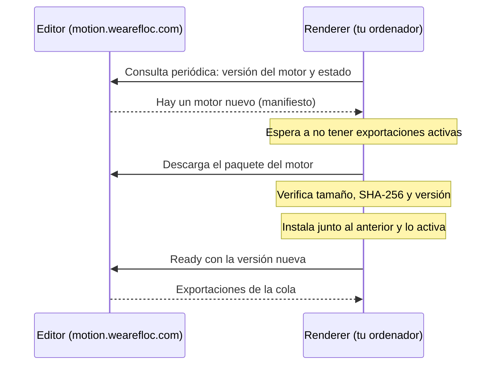

# Actualización automática del Renderer

El Renderer de FLOC Motion ya no hay que descargarlo ni volver a conectarlo con cada versión. **Se instala una última vez y, a partir de ahí, actualiza su motor de render solo**, cuando no está exportando, conservando su conexión con el editor. Los vídeos siguen guardándose en tu ordenador.

## Para quien exporta

### Una sola vez: instalar la versión con actualización automática

1. En el editor, abre **Export → Download renderer**.
2. Descomprime el ZIP en una carpeta nueva y abre **Install-Mac.command** (Mac) o **Install-Windows.cmd** (Windows).
3. Si este ordenador ya estaba conectado, el instalador muestra **“Using the existing connection: …”** y **no pide código**. Solo lo pide en un ordenador nuevo o si el editor ya no reconoce este Renderer.

### A partir de ahí

| Situación | Qué pasa |
|---|---|
| Se publica una versión nueva del editor | El Renderer descarga el motor nuevo, lo verifica y lo activa cuando está libre. No hay que hacer nada. |
| Hay una exportación en marcha | Termina con el motor con el que empezó. La actualización se aplica después. |
| Exportas mientras se actualiza | La exportación espera en la cola (**Waiting for your renderer to update**) y empieza al terminar la actualización. |
| Quieres comprobarlo ya | **Export → Update now**. |
| Algo falla | Sigue funcionando el motor anterior y Export muestra **Needs attention** con el motivo. **Update now** lo reintenta. |

### Estados en Export

| Estado | Significado |
|---|---|
| **<nombre> · Ready** | Conectado, con el motor del editor. Listo para exportar. |
| **Updating engine…** | Descargando o activando el motor nuevo. Las exportaciones nuevas esperan en cola. |
| **Needs attention: …** | La actualización falló; el motor anterior sigue activo. Usa **Update now** o reinstala si lo indica. |
| **Install the latest renderer once** | Es un Renderer anterior a la actualización automática. Haz la instalación única de arriba. |
| **Your renderer is offline** | El Renderer no está en marcha o el ordenador está dormido. |

## Cómo funciona

1. **El editor publica el motor** en cada despliegue: un paquete con solo los archivos que usa el Renderer y un **manifiesto** con su versión, tamaño y huella **SHA-256**.
2. **El Renderer informa** de su versión al consultar si hay trabajo. Si no coincide con la del editor, el editor le responde que hay un motor nuevo, en lugar de darle exportaciones.
3. **El Renderer espera a estar libre**, descarga el paquete y **comprueba** que el tamaño, la huella y la versión resultante son exactamente los publicados. Rechaza paquetes con rutas o enlaces sospechosos.
4. **Instala el motor nuevo junto al anterior.** Si las dependencias no han cambiado, las reutiliza sin volver a descargarlas.
5. **Cambia de motor de forma atómica y se reinicia en él.** La conexión, el navegador de render y los diagnósticos se conservan.
6. **Si el motor nuevo falla al arrancar varias veces seguidas, vuelve automáticamente al anterior** y Export lo indica.

### Qué hay en la carpeta del Renderer

- Mac: `~/Library/Application Support/FLOC Motion/Renderer`
- Windows: `%LOCALAPPDATA%\FLOC Motion\Renderer`

| Elemento | Función |
|---|---|
| `launcher.mjs` | Supervisor estable: mantiene el Renderer en marcha, cambia de motor y restaura el anterior si falla. No se actualiza automáticamente. |
| `current.json` | Motor activo y motor anterior. |
| `engines/` | Motor actual y anterior; los más antiguos se eliminan. |
| `deps/` | Dependencias compartidas entre motores con el mismo `package-lock.json`. |
| `runtime/` | Node privado del Renderer. |
| `.data/` | Conexión, navegador de render y diagnósticos. **No lo compartas.** |

Start, Stop, Uninstall y Repair siguen en la misma carpeta y ahora actúan a través de `launcher.mjs`.

## Seguridad e integridad

- El Renderer solo descarga del **mismo editor al que está conectado**, por HTTPS y sin seguir redirecciones.
- Cada paquete se verifica por **tamaño y SHA-256** antes de usarse, y la versión calculada tras instalarlo debe coincidir con la publicada.
- Las actualizaciones nunca reciben código desde un proyecto: solo instalan motores publicados por el propio editor.
- La credencial de conexión no cambia con las actualizaciones.
- Los paquetes **no están firmados** con una clave independiente; la confianza descansa en HTTPS y en el editor. Es coherente con un instalador interno, pero es la mejora a considerar si el Renderer se distribuye fuera del equipo.

## Límites

- **Cambio de versión de Node:** si una versión futura necesita otro Node, el Renderer lo indica (**Reinstall the renderer to update its Node runtime**) y hay que ejecutar el instalador otra vez. Seguirá sin pedir código.
- **Windows:** el instalador, los enlaces de carpetas (*junctions*), el arranque y la parada se han preparado y revisado, pero **no se han ejecutado en un Windows real**. Conviene probarlo en el primer equipo Windows antes de darlo por cerrado.
- **El worker compartido heredado** (`FLOC_RENDER_WORKER_TOKEN`) no se actualiza automáticamente.
- **El estado de actualización** se guarda en memoria en el editor: tras reiniciarse el servidor, reaparece en la siguiente consulta del Renderer, en pocos segundos.

## Para quien mantiene FLOC Motion

| Tarea | Cómo |
|---|---|
| Publicar un motor nuevo | Nada adicional: `npm run build` genera `dist/renderer/engine/manifest.json` y `dist/renderer/engine/<versión>.zip`, y el despliegue los sirve en `/renderer/engine/`. |
| Comprobar la versión publicada | `https://motion.wearefloc.com/renderer/engine/manifest.json` |
| Cambiar la versión de Node | Actualizar `NODE_VERSION` en `installers/Install-Mac.command` y `installers/Install-Windows.cmd` (el build falla si no coinciden) y pedir una reinstalación. |
| Diagnóstico en un ordenador | `.data/render-worker/launcher.log` y `worker.log` en la carpeta del Renderer. |

### Verificado antes de publicar

- Suite completa y build.
- Instalación nueva con código; reinstalación **sin** código reutilizando la conexión.
- **Migración desde una instalación anterior** ya conectada: sin código, se conservan conexión y diagnósticos y se elimina la estructura antigua.
- **Actualización automática real** a un motor nuevo en unos 8 segundos, con el Renderer libre, misma credencial, y exportación posterior con el motor nuevo guardada en el ordenador.
- **Update now** en Export: pasa por **Updating engine…** y vuelve a **Ready**.
- Pruebas de rechazo: huella o tamaño incorrectos, rutas peligrosas, Node distinto y vuelta al motor anterior tras fallos de arranque.
